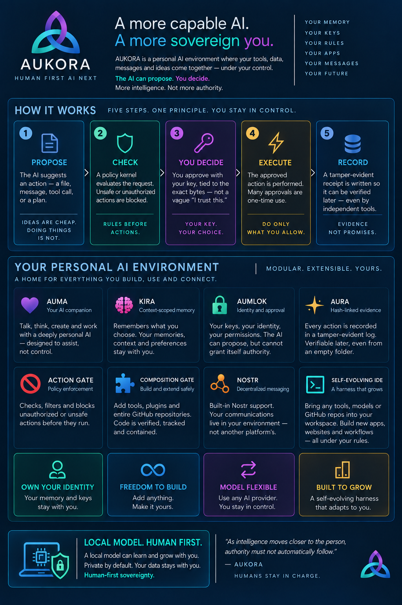

# AUKORA Prime

[Threat model](docs/THREAT-MODEL.md): adversaries, defended actions, limits and evidence.



*Human first. AI next.*

AUKORA aims to become an open personal AI workspace that helps people think, remember, build tools and improve the workspace itself. Models and applications could change while identity, memory, relationships and authority stay with the person. People and their agents could cooperate without handing control to one platform: **the person is the platform**.

[Short overview and reading map](docs/READING-GUIDE.md): purpose, design choices, dated observations and missing work.

**What changed recently:** [component status and runtime joins](docs/STATUS.md) updates the dated observations below and in the reading guide; [review questions](docs/REVIEW-PROMPTS.md) pair claims with checks and limits.

**The software that proposes an act should not be the authority that permits it.**

**Reading the code? Start with [SECURITY-BOUNDARY.md](SECURITY-BOUNDARY.md), then [ARCHITECTURE.md](ARCHITECTURE.md):** how the pilot organism (Genesis runtime, boundary gate, OpenShell sandbox, desktop owner app, Aumlok, Kira, Aura) connects, with shared REPORTED / SOURCE / NOT YET status and links to the existing checks.

**Names used here:** Aumlok is the identity and approval layer; Kira is memory; Aura is the record and verification layer. Auma is the agent in the Genesis-derived runtime. Genesis is the earlier runtime carried into this repository; Prime is this repository, including that pilot code and the separate NEXT packages. `aukora-relay` is the node's [HTTP message service](host/relay/server.mjs); the [Buzz Nostr relay](ops/buzz-relay/README.md) is a separate service. The legacy [file-based relay](scripts/aukora-relay.mjs) is another historical use of the name. Prime Agent is [Prime Intellect's agent, from another project](plan/NORTH-STAR.md).

## Today

**RECORDED: the October 10 readback found release `3673b98` on the Linux pilot, a Nebius VM.** Eight service units were active. The gate, runtime, OpenShell gateway and HTTP relay used separate accounts; memory shared the runtime account. Only SSH listened off loopback, and the Mac desktop app connected through a loopback forward ([readback](evidence/pilot/2026-10-10-readback.md)). This operator-side record does not establish containment or installed-byte parity. The gate package `4c24fd0` remains an October 5 operator report, not a readback of its bytes.

**RECORDED: the later October 12 plan reports Buzz running on the pilot and channel messages from Peter's Mac.** Later staging releases started real harness turns through the configured Buzz door, stopping at a missing model key. **NOT YET:** Auma answering through Buzz. Invites and admission are **SOURCE**; the admission service is not installed. Release-based scratch probes demonstrated text and meaning-based recall through real OpenViking; the live harness returned to `3673b98` after an October 13 rollback. See the [later plan entries](plan/NORTH-STAR.md) and [current component status](docs/STATUS.md).

Prime NEXT is a separate source layer. Its protected owner, memory, execution and inference joins remain unqualified. The [L2 export](docs/evidence/l2-demo-2026-10-04/README.md) retains a signed theme-change receipt and ledger prefix. Source checks and dated records do not qualify the whole product.

```sh
./security-review                 # scoped offline checks; JSON, with exclusions
./prime verify                    # complete NEXT source profile; retain failures
sudo ./security-review-containment # live containment check (root, on the pilot only)
```

**Recursion research:** [Ornith / Nebius Lab report and sanitized digest](research/README.md) — separate research evidence, not a deployed AUKORA model or product qualification.

Read [the security boundary](SECURITY-BOUNDARY.md), [component map](ARCHITECTURE.md), [current claims](docs/CLAIMS.md) and [historical evidence](docs/EVIDENCE-HISTORY.md). [Contribute](CONTRIBUTING.md) or [report a vulnerability privately](SECURITY.md).

The generated tables retain their selected, dated evidence snapshot. [Current component status](docs/STATUS.md) records later staging, memory and admission work without implying that this checkout is the live release.

<!-- BEGIN GENERATED current-revisions -->
| Identity | Revision / observation | Meaning |
| --- | --- | --- |
| Source account | `70d180f38bdd701c3c25e0e4f196fd82dbe3e091` | Base reviewed for this documentation snapshot; the review command emits the received HEAD and dirty state. |
| Public main observed | `03adf90c40225e823b1bf0282aff1be2728e9f69`, 2026-10-04T16:00:00Z (integration tree before this evidence commit; SOURCE, ahead of the deployment) | Read/fetch observation, not a deployment proof; main may advance. |
| Pilot deployment | `3673b98a3e090d122ed0853386ff60913287c3a8`, 2026-10-05T12:41:00Z · **REPORTED** | Release 3673b98 was read back running on the pilot at 2026-10-10T06:02Z, an operator-side readback from the owner's machine (evidence/pilot/2026-10-10-readback.md), not an independent attestation. The installed gate package remains Peter-reported as the old package 4c24fd0. No normal admitted shell or accepted bound workspace. Later source commits and observer success do not establish admission, containment closure or whole-product acceptance. |
| Tested revision | Per-check HEAD and file digests from `./security-review` | No current test result is inferred from a commit message or this table. Historical results stay in [evidence history](docs/EVIDENCE-HISTORY.md). |
<!-- END GENERATED current-revisions -->

## Check it yourself

Use Node 24.11.1, an existing Python 3.9 or later at `/usr/bin/python3`, and an environment that permits disposable private Unix-domain sockets. Use `umask 0022` in the disposable source-check shell; private fixture state still specifies restrictive modes explicitly. A wrapper that silently changes the child umask can change filesystem-refusal fixtures and must be recorded as a different test environment. Restricted sandboxes can reject the IPC fixtures with `EPERM`; retain that failed/blocked result rather than treating it as PASS. Run the command above from the repository root.

The [October 12 plan](plan/NORTH-STAR.md) records **62 PASS / 0 FAIL / 13 UNPERFORMED** at `8f186df` on the Mac with Node 24.11.1. This is a retained report, not a run of the received revision. The earlier **61 PASS / 1 FAIL / 4 UNPERFORMED** result remains in the [historical account](docs/archive/README-before-audit-surface.md). The profile keeps missing acceptance visible with exit `2`; report its exclusions even when no job fails. Source verification does not establish whole-product acceptance.

The shorter `./security-review` runs the fixed offline profile described in [SECURITY-BOUNDARY.md](SECURITY-BOUNDARY.md). It prints received HEAD, dirty state, boundary-file digests, every check's actual exit/result and declared unperformed arms as JSON. Use `./security-review --list` to see its commands without executing them; use `--logs /tmp/aukora-review-private` to retain private raw output. Exit `1` means a check failed; exit `2` preserves open live acceptance even if all scoped checks pass. No check is run merely by reading this README.

If repository access is available, a fresh review starts with:

```sh
git clone --branch main https://github.com/aumara-xyz/aukora-prime.git
cd aukora-prime
```

For a standalone sanitized source bundle, use `git clone --branch main aukora-prime-sanitized.bundle aukora-prime`, then run the verification command above. A bundle’s default branch can otherwise differ from its contained `main` ref.

The historical receipt does not attest the received revision. [CI source checks](docs/CI.md) require a separately observed Actions run; adding a workflow is not an execution result. Preserve the revision and complete result you receive, including failures and unavailable checks. The [evidence history](docs/EVIDENCE-HISTORY.md) retains earlier runs and the immutable release receipt. The [profile description](packages/ops/fast-verify/README.md) states scope and exclusions; owner enrollment, provider credentials, a database and an OpenShell guest are not prerequisites for the public source profile.

## From a clone to a running system

Use Node **24.11.1** with its development headers, Python 3.9 or later, git, a C compiler (`cc`) and the package manager pinned in `upstream-dsh.json` (currently `pnpm@11.7.0`). The following smoke check makes another clean clone, obtains the pinned MIT DeepSeek harness archive, verifies its SHA-256, applies the pinned patches, builds and materializes a release. It starts a temporary gate and release as your current user, with throwaway keys and a real plugin-set approval. It does not use the machine's installed gate or model credentials.

```sh
git clone --branch main https://github.com/aumara-xyz/aukora-prime.git
cd aukora-prime
node --version                    # must print v24.11.1
npm install --global pnpm@11.7.0
./scripts/fresh-clone-check.sh .
```

The check signs in with that release's launch token, checks the UI, face-plugin load failures, thread icon and carried stock apps, requires HTTP 401 without authentication, and exercises an action-gate refusal. It prints the rows and elapsed time, then stops the processes and removes its private temporary state. Exit `0` means every row passed; exit `1` means a check failed; exit `2` prints `UNPERFORMED: <reason>` for an unavailable prerequisite. The **fresh clone boots** Ubuntu CI job runs this command on every push, caching only the archive and verified harness build by their pinned inputs.

An offline archive still has to match the pin. The check uses an empty dependency store, so a fresh build still needs registry network access. `--built` skips only the harness build and verifies the supplied build before materializing:

```sh
./scripts/fresh-clone-check.sh . --archive vendor/dsh-source.tar.gz
# Reuse a verified built harness: the output explicitly marks the build skipped.
./scripts/fresh-clone-check.sh . --archive vendor/dsh-source.tar.gz --built vendor/dsh
```

No model key is needed to start the release, serve its interface and apps, or check these refusals. A model reply needs a configured provider and its credentials; this check sends no model request. It verifies a temporary gate's signed approval and exact release floor, then uses the existing unprivileged Aumlok approval commands with a disposable scripted signer for launch. Its same-user authority proves the boot and approval path it exercises, not separate-user containment, real owner enrollment, persistent installation, a paid reply, or qualification of the live pilot. Production still uses the protected installed gate and the owner's approval route described in [the pilot procedure](ops/pilot/README.md).

## Status

### Status glossary

**REPORTED** is an operator account, not independently observed here. **RECORDED** is dated retained evidence. **SOURCE** means code is present, without a current-head test or installed-system claim. **NOT YET / UNPERFORMED** names a missing implementation or check; **PROPOSED** names a direction; **RESEARCH** names a separate retained research report. A review command's **PASS / FAIL** applies only to its exact row and revision. No percentage describes trust.

<!-- BEGIN GENERATED current-claims -->
| Claim | Status / basis | Code or check | Limit |
| --- | --- | --- | --- |
| Separate-user Linux pilot runs the Genesis-derived runtime, the boundary gate, the OpenShell gateway and sandbox, the relay and the desktop owner route. | **RECORDED** · Runtime readback from the owner's machine, 2026-10-10 05:56 and 06:02 UTC: eight AUKORA service units active on a Nebius VM; Genesis runtime release 3673b98, boundary gate, OpenShell 0.1.2 gateway and sandbox, and HTTP relay under separate accounts; memory shared the runtime account; only SSH listening off loopback; desktop owner app attached through a loopback forward; evidence at 2026-10-10T06:02:11Z | [component map](ARCHITECTURE.md); [readback record](evidence/pilot/2026-10-10-readback.md) | Operator-side readback, not an independent attestation. Running processes and services do not establish containment: the 2026-10-04 result remains FAIL and the inherited-descriptor finding is open. Normal shell admission, a bound workspace, installed bytes and the gate package version (Peter-reported 4c24fd0) were not read back. Owner enrollment remains unperformed. Later source commits and observer success do not establish admission, containment closure or whole-product acceptance. |
| The pilot runtime mounts the action gate and Kira memory. | **REPORTED** · Peter reports live release 3673b98. The 2026-10-10 readback saw the runtime process and its composition-gate plugin import; it did not exercise the action gate or Kira. The October 12 plan correction reports the memory service up and one saved note without indexing or search; evidence at 2026-10-12 (plan correction; no rerun) | [component map](ARCHITECTURE.md); [readback record](evidence/pilot/2026-10-10-readback.md); [October 12 corrections](plan/NORTH-STAR.md) | Memory indexing, search and recall are not demonstrated. The October 10 readback did not exercise the action gate or Kira. Host file fences and a source guard do not establish complete mediation or containment. |
| October 12 records Buzz relay deployment on the pilot and channel messages from Peter's Mac. | **RECORDED** · Later North Star entries report the separate loopback Buzz Nostr relay and Mac desktop channel messages; evidence at 2026-10-12 | [October 12 records](plan/NORTH-STAR.md); [relay install source](ops/buzz-relay/README.md) | Auma's reply route remains unqualified. The relay was recorded open to node logins and tunnel users. Invites are NOT BUILT. The pinned Buzz fork is private; this task did not inspect it or contact the pilot. |
| A release built from main at 22b9c0d started in the pilot's staging container; the Buzz door was mounted but unconfigured. | **RECORDED** · North Star records staging approval by its stand-in owner key, a passed release-floor check and an interface returning HTTP 401 without a token; evidence at 2026-10-12 about 11:15 UTC | [later staging record](plan/NORTH-STAR.md); [door source](plugins/aukora-buzz-door/lib/index.mjs) | Staging only; the live harness was unchanged. The door reported unavailable without a key or configuration. A wake and Auma answering through Buzz were NOT RUN. This is a retained operator record, not a new runtime observation. |
| A theme proposal reached owner review, was approved once and applied with a signed receipt. | **RECORDED** · L2 signed export, 2026-10-04; ledger #1–#24 | [export and verifier](docs/evidence/l2-demo-2026-10-04/README.md) | Signatures and matching bytes are checkable offline. Hot reload is operator-recorded; this export does not establish current ledger completeness, human identity or comprehension. |
| Agent proposal and owner approval use separate gate channels; review binds exact change bytes. | **REPORTED** · Peter reports the installed gate remains the old package 4c24fd0; separate channel/exact-byte review mechanism exists in source; evidence at 2026-10-05T12:41:00Z | [gate](packages/boundary-gate/src/gate.mjs); [existing signer check](tests/aukora-plugin-set-gate-signer.test.mjs) | Live runtime 3673b98 does not imply gate-package parity. This docs task did not verify installed bytes, human attendance, native owner-key enrollment or hardware custody. |
| Pre-Node gate-bootstrap and v2 approval floor have retained installation evidence; current gate-package parity is not established. | **REPORTED** · Historical 3ac3509 PACKAGE_VERIFIED/floor readback is retained; Peter now reports live 3673b98 with old gate package 4c24fd0; evidence at 2026-10-05T12:41:00Z | [root bootstrap](packages/boundary-gate/host/install/gate-bootstrap.py); [bootstrap trust/limits](packages/boundary-gate/src/vendor/TRUSTED-VERIFIER.md); [existing VM fixture check](packages/boundary-gate/src/vendor/check-trusted-verifier.mjs) | No current bootstrap, floor or package readback ran here. Historical signer epoch/ledger sequence is not a current installed claim; rollback still needs fresh owner approval. |
| Landed card clarity shows gate-decided ROUTINE/CRITICAL, one plain action line and gate facts before fenced model text; approval stays one click without typing/reveal/scroll/dwell. | **REPORTED** · Supplied card/gate installation report; native app patched and relaunched with bridge polling; evidence at 2026-10-04T08:50:33Z | [one-click check](tests/aukora-owner-card-no-friction.test.mjs); [model-fence check](tests/aukora-owner-card-model-fence.test.mjs) | Recorded card installation plus source presence does not measure comprehension or attendance, prove native owner-root enrollment, or attest the current rendered window in this docs task. |
| No normal admitted shell or accepted bound workspace; containment and admission remain open. | **REPORTED** · Peter status report: live 3673b98, no normal admitted shell, no accepted bound workspace. Earlier bound guest 33 DENIED / 0 ALLOWED was ADMISSION-BYPASSED; host-as-auma 40 DENIED / 7 ALLOWED. Kimi later reports observer pass, with admission blockers remaining.; evidence at 2026-10-05T12:41:00Z | [scope](plugins/aukora-openshell-confinement/README.md); [wrapper](packages/boundary-gate/host/sbx-exec); [live containment test](security-review-containment); [auma local-service deny](host/auma-local-deny/README.md); [dated findings and disposition](evidence/containment/2026-10-04.md) | ADMISSION-BYPASSED guest results do not qualify the normal route. Observer pass does not clear admission or the host allowed routes. Historical inherited-descriptor finding remains retained; no live check ran in this docs task. |
| The service runs a fail-closed self-check before start and on a 15-minute timer. | **REPORTED** · Production self-check/timer account plus disposable transient start-gate proof: forced failure blocked the unit main process; evidence at 2026-10-04T11:39:37Z | [existing stubbed check](packages/boundary-gate/checks/selfcheck-bin.mjs); [units](packages/boundary-gate/host/systemd/README.md) | The transient proof establishes before-start failure handling, not a live sabotage or continuous gate-service loss dependency. The reported BindsTo/RemainAfterExit unit change is pending; source/RPC stubs do not establish current egress policy. |
| The installed INTERIM Aura collector ran; cold verification passed through ledger position 153 with an anchor verified. | **REPORTED** · Supplied e337397 collector cold-verification result; evidence at 2026-10-04T10:44:52Z | [collector scope](scripts/aura/README.md); [interim install](host/aura-interim/README.md) | INTERIM pilot-generated owner/controller keys are not enrolled native owner custody. Root-recorded anchors are not an independent witness. The replacement collector and actual per-note Kira/Aura association remain separate pending acceptance. |
| Prime NEXT contains stricter authority, retained-memory, inference, bridge and guardian components. | **SOURCE** · Retained NEXT source and dated connected mock/build records | [NEXT map](docs/PRIME-NEXT-ARCHITECTURE.md); [checkpoint](docs/development/INTEGRATION-CHECKPOINT-2026-10-02.md) | These packages are not the pilot runtime. Native request production, protected joins, genuine provider reply and complete runtime acceptance remain unfinished. |
| The October 12 full NEXT source-profile report records 62 PASS / 0 FAIL / 13 UNPERFORMED at 8f186df. | **RECORDED** · North Star records a Mac run with Node 24.11.1; the suite verdict was UNPERFORMED | [October 12 source-profile report](plan/NORTH-STAR.md); [original account](docs/archive/README-before-audit-surface.md); [immutable history](docs/EVIDENCE-HISTORY.md) | This is not current-head execution or GitHub CI evidence. The earlier 61 PASS / 1 FAIL / 4 UNPERFORMED account remains historical; no product acceptance follows from either report. |
| One synthetic-P256-approved save ran through PG 16 with authority UID 995 and memory UID 994; independent authority, memory and DB restarts preserved bytes, citation and receipt. | **RECORDED** · Dated bounded synthetic experiment | [sanitized summary](docs/evidence/bounded-memory-experiment.json) | One older synthetic save, cleaned up; not real owner enrollment, indexing/search or current product qualification. |
| Real owner passkey enrollment, hardened root recovery and hardware custody. | **NOT YET** · No selected public acceptance receipt | [known gaps](README.md#known-gaps) | Owner enrollment is the owner’s action. A passkey with user verification proves a real authenticator, not hardware custody, who the human is or informed consent. |
| Hybrid ML-DSA-65 + Ed25519 signature and hybrid KEM experiments exist. | **SOURCE** · Standalone lab on pinned Noble dependencies | [lab scope](labs/pq-hybrid/README.md) | NOT LIVE; grants no authority and does not qualify a deployed identity/receipt migration. |
| Registered agents, human networking, replaceable providers/apps and broader capability cells. | **PROPOSED** · North Star and field design | [plan](plan/NORTH-STAR.md); [field patterns](plan/FIELD-DISTILL.md) | Research directions; source fixtures and one pilot do not establish a working global platform. |
| Ornith / recursion experiments have a dated public report and sanitized evidence digest. | **RESEARCH** · PR #10 merge 6f9e6f433924800e365c7e400a6c4bdb30bcdc79; report snapshot 2026-10-04 07:45 UTC | [research index](research/README.md); [sanitized digest](research/evidence/NEBIUS-LAB-2026-10-04.json) | Retained report/digest inspection, not complete independent reproduction. No training/GPU evaluation ran in this cleanup; no deployed AUKORA provider or product acceptance follows. |
<!-- END GENERATED current-claims -->

## Containment baseline

<!-- BEGIN GENERATED current-containment -->
**Current admission · REPORTED at 2026-10-05T12:41:00Z:** Peter status report: live 3673b98, no normal admitted shell, no accepted bound workspace. Earlier bound guest 33 DENIED / 0 ALLOWED was ADMISSION-BYPASSED; host-as-auma 40 DENIED / 7 ALLOWED. Kimi later reports observer pass, with admission blockers remaining. ADMISSION-BYPASSED guest results do not qualify the normal route. Observer pass does not clear admission or the host allowed routes. Historical inherited-descriptor finding remains retained; no live check ran in this docs task.

**Historical containment baseline. ANY ALLOWED = FAIL; missing enumeration or a detecting control cannot establish PASS.** The supplied operator result at 2026-10-04T13:42:00Z for runtime `3ac3509a25fbfd03fd50a670f1fcdfef2aa5470e` remains **FAIL**: guest **34 DENIED / 1 ALLOWED** (socket descriptors inherited inside the guest from the OpenShell exec path; the host launcher closure 7cfe8d7 is installed; protected-target reach not established); host-as-auma **35 DENIED / 0 ALLOWED** after the host firewall.

The original baseline at 2026-10-04T10:43:00Z had guest **34 DENIED / 1 ALLOWED** and host-as-auma **33 DENIED / 2 ALLOWED**. The observer was unchanged; signed ledger prefix through 153 intact. The disposable control had 20/20 allowed routes, 7/7 decoy changes detected; PROVES DETECTION; that is detection evidence, not containment PASS. Workspace operations were reported working.

See the [three findings and their disposition](evidence/containment/2026-10-04.md), [command scope](scripts/audit/containment/README.md) and [host-firewall scope](host/auma-local-deny/README.md). The inherited-descriptor finding stays OPEN. Required evidence: normal admitted route and bound workspace, closure of guest/host findings, plus outside-observer/control evidence; no PASS inferred from bypassed admission, observer success or source landing. This docs task reran no live check; full containment remains unqualified.

**Named host-as-auma exceptions · REPORTED at 2026-10-06T09:00:00Z:** host-as-auma probes on the staging bound workspace via the normal admitted route (44 DENIED / 6 ALLOWED / 6 INFO); guest via the same route: 33 DENIED / 0 ALLOWED. Peter 2026-10-06 (decision 2f): the six do not block the candidate; they are named here for outside reviewers to judge.

- `unix /run/user/1001/podman/podman.sock` — auma's own rootless podman socket; post-escape depth; lets host-auma create containers outside the gateway inventory; CLOSURE DESIGN NEXT
- `unix /run/user/1001/bus` — auma's own session D-Bus; self-owned session resource
- `unix /run/user/1001/systemd/private` — auma's own systemd user-session socket; self-owned session resource
- `tcp 127.0.0.1:17690` — the OpenShell gateway auma herself owns (mTLS); her own service; the guest route to it stays DENIED
- `abstract @86d0b` — abstract socket, type 2; session-scoped; origin under review
- `CLONE_NEWUSER\|CLONE_NEWNS` — unprivileged user+mount namespace creation; standard for a subuid login user; lets host-auma build her own sandboxes; CLOSURE DESIGN NEXT

ANY ALLOWED = FAIL; naming is disclosure, not acceptance.
<!-- END GENERATED current-containment -->

Review in order: [security boundary](SECURITY-BOUNDARY.md) → [architecture](ARCHITECTURE.md) → [verification scope](#check-it-yourself) → [Golden Boundary paper](docs/AUKORA-GOLDEN-BOUNDARY.md) → [separate recursion research](research/README.md). Runtime records, offline checks, NEXT source and research have separate scopes.

## Known gaps

- The pinned harness recipe includes the captured-ID Cordis logger disposal fix and the per-read gateway cancellation fix, with exact patch digests and MIT notices. The six-patch recipe is built into the deployed release (operator-reported: the launcher binds 8389 compiled artifacts to 6 exact patches); the earlier four-patch build receipts remain historical.

- The historical local source-profile run failed `full-owner-recovery` and left four jobs unperformed. The [October 12 plan](plan/NORTH-STAR.md) records a later 62 PASS / 0 FAIL / 13 UNPERFORMED run at `8f186df`. Neither is a current-head result. The earlier six-failure [CI result at `8fda787`](docs/evidence/source-profile-ci-8fda787.json) remains retained.
- An attempted pre-reservation refusal remains unknown until authoritative C/D non-consumption, absence of an intent/effect and writer closure can be established together. No UI callback or missing-effect exception clears that fence. The affected owner-effect runtime stays unavailable.
- The retained-memory source protocol now includes authority preparation, request-bound dispatch and factual settlement. Its authenticated separated-worker phase adapter is not implemented or qualified here. Retained-profile restore refuses until its lineage is established; no stale checkpoint or success flag can replace that evidence.
- Logout, logical forget and verified-receipt recovery have source joins. Current served behavior and the protected owner path still need acceptance. An unknown outcome retains its consumption and replay fence; reconciliation is not permission to repeat an effect. Logical purge does not promise erasure of physical media, WAL or external copies.
- The retained NEXT owner build binds 87 source inputs and 46 generated outputs; the compiled native Cordis/H fixture passed 11 groups. Synthetic owner and read-only reply views were observed separately, as recorded in the [checkpoint](docs/development/INTEGRATION-CHECKPOINT-2026-10-02.md). The prepared `baef862` release predates later E/F increments and is unbooted. Each changed source revision needs its own build/composition/served-byte evidence before an installed-product claim. Models display does not enable credentials or inference.
- The native owner/task/conversation request producer remains missing. Memory projection requires a fresh exact-binding acknowledgement; a stale binding or uncertain outcome cannot create a new approval or effect. The default protected composition remains unmounted.
- Same-UID witness rollback remains a declared limit. Candidate-writable state and its reference cannot establish independent authority. A separate UID also needs authenticated IPC, protected configuration, owner proof and actual target enforcement.
- The owner's real passkey enrollment requires the owner's action and remains unperformed. A real passkey with user verification does not prove hardware custody, human identity, comprehension or freely given attendance. Lost-device revocation, key rotation, owner recovery and challenge-abuse recovery remain hardening work. Source challenge quotas are bounded; they do not complete that account.
- OpenShell execution RAN on the pilot as one-shot commands in the `auma` sandbox (see the status table); the `packages/execution` path below is not that path. Full effective-configuration readback, a durable final-verification fence, conservative timeout/null-exit handling and the mounted factory’s tracked Cordis effect are integrated source. The atomic expected-policy execution fence, external cleanup supervisor, resources and actual remote absence remain unqualified. Cordis disposal and logical service isolation do not establish those runtime properties.
- The protected NEXT inference path has no qualified live reply. Source now contains immutable total-budget descriptors, cross-task reservations, original pre-reserve attempts, held dispatch continuation and durable evidence/outbox. The [connected mock pilot](docs/evidence/next-dsh-pilot-e994789.json) checks their join; it does not qualify independent spend-store custody, rollback, secure credential entry, protected host binding or a real paid reply. The USD 10 total / USD 0.01 first-request example is inert data. Real dispatch requires separately approved caps, data scope and qualified route/rate/terms/version inputs. Plaintext request/receipt/reply retention remains disclosed in the [inference handoff](packages/inference/next-development-handoff.md).
- Guardian registrations, original wall deadlines and cleanup intent are retained in source, but the pinned backend refuses unsupported reclamation. Workload images are unbuilt definitions with null output digests. Actual execution, resource enforcement, atomic configuration and complete external cleanup remain unqualified.
- Threads needs an available read-only workspace host or an explicit unavailable state. New capture review binds the complete statement, attribution, fixed metadata and selected evidence quote. New text must already be NFC and satisfy the declared control-character policy; historical bytes are preserved. The Apps donor build receipt remains historical; a new Apps source build is unperformed.
- Voice and vision remain unavailable: their donor hosts and authority doors are unmounted, and the Prime static route refuses the AumaLive and Lingwa pages and their voice entry modules. Source presence does not establish local processing or measured egress. A Mac preview can send entered content to its Linux host; see the [data residence account](docs/PRIME-NEXT-ARCHITECTURE.md#data-residence-in-the-preview).
- A second-machine reproducible release digest remains unconfirmed. [GitHub private vulnerability reporting is enabled](SECURITY.md); no separate private email contact or response-time commitment is established.

The live agent is not yet fully contained. Root and identity design still need hardening. Each repaired defect needs a focused regression, and each runtime claim needs evidence from the configured path that actually ran.

## Genesis lineage

Prime carries the full public [AUKORA Genesis](https://github.com/aumara-xyz/aukora-genesis) runtime from Genesis main `9572138ef140311867bcf140e07f0e58d023c61f`, squashed into Prime as one commit (`c358ac7`, 2026-10-04): apps/aukora-desktop, plugins, presets, overlays, vendor, scripts, labs and Genesis tests, with Prime's packages, docs and tests kept beside it. Earlier selected donor material (identity/approval, memory/evidence and UI foundations, originally pinned at `645d3213b8aede3b544269b4224ae09df06b0a42`) remains recorded below. The [donor record](provenance/donors.json), [component ledger](provenance/core-ledger.json) and [notices](licenses/README.md) identify what was retained. Prime keeps that selected material locally; no sibling Genesis checkout is required. Genesis observations do not automatically qualify Prime. Some other historical donor locations remain unavailable; see the [specific source-availability account](licenses/DONOR-SOURCE-AVAILABILITY.md).

## Read and contribute

- [Short overview and reading map](docs/READING-GUIDE.md), [complete Golden Boundary paper](docs/AUKORA-GOLDEN-BOUNDARY.md) and [review guide](SHARE.md)
- [NEXT source checkpoint](docs/development/INTEGRATION-CHECKPOINT-2026-10-02.md), [join decision](docs/development/INFERENCE-JOIN-DECISION.md) and [changelog](CHANGELOG.md)
- [Contribute a question, correction or patch](CONTRIBUTING.md) · [Architecture and build instructions](docs/PRIME-NEXT-ARCHITECTURE.md) · [CI source checks and limits](docs/CI.md)
- [License inventory](licenses/README.md), [AGPL v3 text](LICENSE), [donor provenance](provenance/donors.json) and [component ledger](provenance/core-ledger.json)
- [Report a vulnerability privately](SECURITY.md)
- [Contributor rules](AGENTS.md), [Claude instructions](CLAUDE.md) and [optional deep-review questions](docs/VISION-QUESTIONS.md)
- [Recursion / Nebius Lab research](research/README.md) — dated report and sanitized digest, separate from product evidence.

First-party software declares **AGPL-3.0-or-later**. Third-party code retains its own licenses: DSH is MIT, OpenShell is Apache-2.0, and vendored dependencies keep their notices. The byte-identical AUMA canon and readers carry **CC-BY-SA-4.0** in their pinned public language publication; the [Auma source and attribution notice](licenses/AUMA-LINGWA-NOTICES.md) preserves that grant and the older donor’s AGPL declarations. See the inventory for the selected closure and its gaps. Prime’s software license is unchanged.
